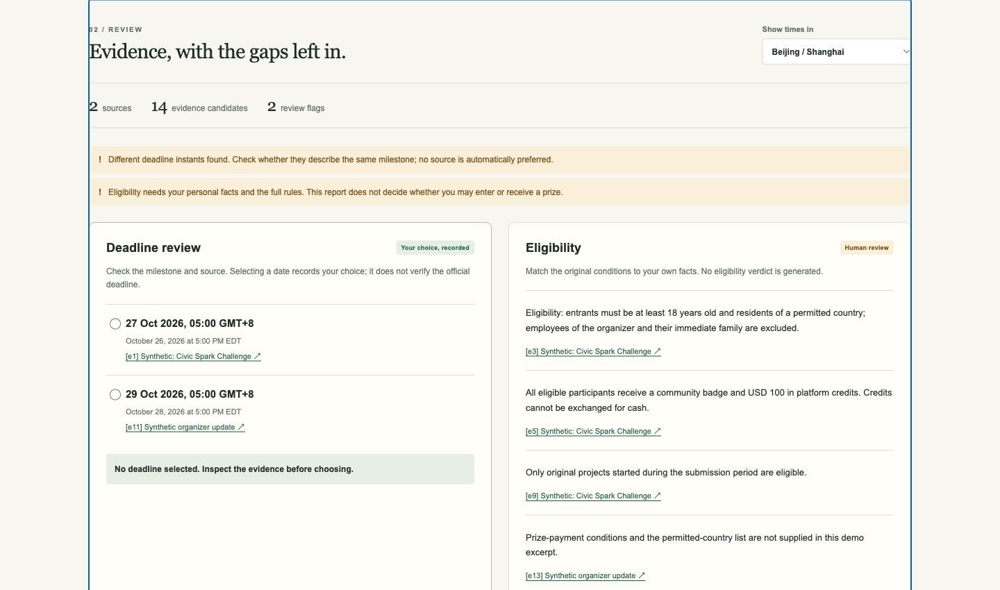

# RuleTrace

[Try the live app](https://cgair.github.io/ruletrace/) · [Watch the demo](https://youtu.be/yXzfrWDzOv0) · [Public repository](https://github.com/cgair/ruletrace)

A local evidence workbench for solo hackathon entrants. Paste English competition rules and an update, inspect source passages and deadline conflicts, then export a preparation checklist and an explicitly selected calendar deadline.

**Prototype boundary:** deterministic candidate extraction, not complete natural-language understanding, legal advice, or an eligibility decision. No runtime AI model, API key, account, analytics, or paid service. AI assisted planning and implementation; see [disclosure](docs/ai-and-third-party.md).

## Run

Requires Node.js **22+**. No third-party npm packages or installation step.

```sh
cd build-with-ai-basics-2026
npm start
```

Open **http://127.0.0.1:4173**. Stop with Ctrl+C. If that port is busy, use `PORT=4174 npm start` and open the matching address. The server listens only on loopback and exposes an explicit file allowlist, not your project directory.

```sh
npm test
```

Uses Node's built-in test runner. See [actual validation record](docs/verification.md), including browser checks and limits.



*Actual application screenshot with synthetic event data.*

## Try the complete loop

1. Click **Try a deadline conflict**, then **Trace the rules**. The fixture is clearly labelled synthetic; it is not the Build With AI rules.
2. Compare the two deadline candidates. In Beijing/Shanghai they display **27 Oct 2026 05:00** and **29 Oct 2026 05:00**.
3. Open the update's evidence link in the result to see the original passage highlighted inside the app.
4. After inspecting it, select the update deadline. This records your choice; it does not certify which rule is authoritative.
5. Check a preparation task. Download the Markdown report and ICS event. Warnings remain in both. The selected synthetic event is `2026-10-28T21:00:00Z` in UTC.
6. Try **missing context**. `CST` is ambiguous, so there is no calendar export. Eligibility is shown as not found, not as unrestricted.

## Inputs and boundaries

- English text, up to 60,000 characters across two sources. One condition per line works best; line-based matching can miss heading-only context or paraphrases.
- Source links are optional HTTP/HTTPS references. They are **not fetched or verified**.
- Parsed dates require an explicit year, clock and supported zone, e.g. `October 26, 2026 at 5:00 PM EDT` or `2026-10-26T21:00Z`. ISO examples use minute precision.
- Supported zone tokens: UTC, GMT, Z, EDT, EST, PDT, PST and numeric ±HH:MM/±HHMM (UTC/GMT prefixes supported in English dates). These abbreviations have fixed offsets. They do not infer a location's daylight-saving rules.
- ET, PT, CST, IST, date-only strings, missing years/zones and unsupported syntax remain unresolved. Display conversion uses IANA zones through `Intl`.
- Different instants are flagged for review. They might refer to different milestones, not contradictory rules; the user decides after inspecting the sources. The tool does not detect every non-date contradiction.
- Prize labels are conservative hints. Dollar-denominated credits are not added to cash totals. Complex mixed/negated award wording still requires inspection.
- Missing-category warnings are not a completeness audit. A detected eligibility passage does not prove the residence list, tax conditions or all exceptions were supplied.
- There is no automatic saving. Text/results/check marks stay in tab memory and disappear on reload. Download the report to keep your work.
- Source text is rendered using text nodes; source instructions cannot trigger actions. Safe source links open only when clicked.

## Project map

- `src/analyzer.js`: `analyzeSources`, `parseDates`, evidence offsets, review flags.
- `src/app.js`: form, rendering, source dialog, human deadline choice, downloads.
- `src/export.js`: Markdown/ICS, citation preservation, calendar escaping and UTF-8 folding.
- `src/samples.js`: invented demo fixtures.
- `scripts/server.mjs`: local allowlisted static server.
- `tests/`: focused regressions and export checks.
- `devpost/`: pre-build scope, PRD, spec, checklist and [offline app map](devpost/app-map.html).
- `docs/`: rule-check evidence, technical disclosure, verification and submission preparation.

## Official Skill Pack

Read and used before writing product code: [challengepost/learn-ai-basics](https://github.com/challengepost/learn-ai-basics), commit `a0f065781873e8a7ed9a9a705a8dafa6a0810439`.

For this build the six unmodified skills were installed project-locally at `.agents/skills/`, copied from the pinned repository clone. They are development resources, not runtime code. To reproduce the same local installation from an empty checkout:

```sh
git clone https://github.com/challengepost/learn-ai-basics.git .curriculum
git -C .curriculum checkout a0f065781873e8a7ed9a9a705a8dafa6a0810439
mkdir -p .agents/skills
cp -R .curriculum/skills/. .agents/skills/
```

The user's explicit autonomous-work instructions overrode repeated interview/approval gates. Plans therefore honestly remain `draft` with `execution: delegated`; learner review is not fabricated. [Skill-use record](docs/skill-use.md) describes what was actually done and what remains unconfirmed.

## Competition status

Built as a new project during the Build With AI: Basics submission period. The current official deadline was rechecked on 2026-10-11: October 26, 2026, 17:00 EDT (October 27, 05:00 in Beijing). Required planning documents were created before the first application-code commit. [Rule verification](docs/rules-checklist.md), [actual validation](docs/verification.md), and [publication status](docs/publication-record.md) are documented separately.

MIT licensed. Original application code was started in this new project directory; no old competition code, credentials or personal data were imported. See [LICENSE](LICENSE) and [third-party notices](THIRD_PARTY_NOTICES.md).
